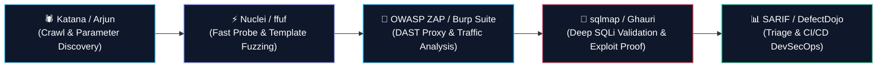

  

  
  
  
  
  
  

---

# 🛡️ Awesome Penetration Testing &amp; SQL Injection

> **A curated directory of top Dynamic Application Security Testing (DAST) scanners, SQL injection automation engines, exploit validation frameworks, and DevSecOps tools for ethical hackers and AppSec professionals.**

Welcome to the definitive hub for **Penetration Testing &amp; SQL Injection (SQLi)**. SQL injection continues to rank among the most critical vulnerability classes in application security (OWASP Top 10 A03:2021 – Injection). This repository tracks industry-leading **enterprise SaaS platforms** and **active open-source GitHub projects** designed to discover, fuzz, enumerate, and safely validate injection flaws across databases, APIs, single-page applications, and microservices.

---

## 📑 Table of Contents

- [📊 Sector Overview &amp; Market Dynamics](#-sector-overview--market-dynamics)
- [🏢 SaaS &amp; Commercial DAST Platforms](#-saas--commercial-dast-platforms)
- [💻 Open-Source Penetration Testing &amp; SQLi Repositories](#-open-source-penetration-testing--sqli-repositories)
- [🛠️ Recommended Penetration Testing Stack Combinations](#️-recommended-penetration-testing-stack-combinations)
- [🌟 Star History](#-star-history)
- [💖 Support &amp; Sponsorship](#-support--sponsorship)
- [🤝 How to Contribute](#-how-to-contribute)
- [⚖️ Legal &amp; Authorized Testing Disclaimer](#-legal--authorized-testing-disclaimer)

---

## 📊 Sector Overview &amp; Market Dynamics

The global **Penetration Testing Market** is valued at approximately **$2.4 billion to $2.8 billion in 2026** and is projected to expand at a **CAGR of ~16.5% to surpass $5.2 billion by 2030**, alongside the broader **Dynamic Application Security Testing (DAST)** sector scaling from **$3.6 billion to over $8.5 billion** driven by cloud modernization, API proliferation, and compliance mandates (PCI DSS v4.0, DORA, HIPAA).

The sector exhibits **moderate fragmentation rather than a winner-take-all dynamic**: while large enterprise incumbents (such as Qualys, Tenable, Rapid7, and Invicti) anchor compliance reporting and enterprise-wide asset coverage, specialized developer-first DAST solutions and vibrant open-source security toolkits (such as sqlmap, OWASP ZAP, and Nuclei) capture substantial developer and security researcher mindshare, leading enterprise teams to adopt heterogeneous multi-tool security stacks.

---

## 🏢 SaaS &amp; Commercial DAST Platforms

The table below catalogs premier commercial and SaaS web application penetration testing and DAST platforms, sorted in descending order by company scale (**Market Capitalization, Annual Recurring Revenue, or Private Valuation**).

| 🏢 Product / Platform | 📈 Company Scale (Valuation / Revenue) | 💰 Specific Starting Price | 🎁 Specific Free Tier / Free Trial Limit | 🎯 Key Capabilities &amp; SQLi Focus |
| :--- | :--- | :--- | :--- | :--- |
| **[Qualys WAS](https://www.qualys.com/apps/web-app-scanning/)** | **~$5.5B Market Cap** ($554M+ ARR, NASDAQ: QLYS) | **$1,995 / year** (Base package covering up to 25 web application targets) | **30-Day Free Trial** (Full-featured scanning for up to 1 web application and 1 REST API target) or Community Edition capped at 1 external FQDN | Enterprise cloud DAST scanner delivering deep crawling for modern SPAs, automated SQL injection testing, OWASP Top 10 auditing, and Swagger/OpenAPI API ingestion. |
| **[Tenable Web App Scanning](https://www.tenable.com/products/tenable-io/web-app-scanning)** | **~$4.8B Market Cap** ($860M+ ARR, NASDAQ: TENB) | **$6,790 / year** (Nessus Expert standalone) or ~$7,400/yr for Tenable One WAS cloud 5-FQDN pack | **30-Day Evaluation Trial** (Up to 5 concurrent cloud scans on designated evaluation targets, full OWASP Top 10 &amp; SQLi tests) | Accurate black-box DAST engine analyzing single-page apps (React/Vue/Angular), API endpoints, and blind/time-based SQL injection with comprehensive attack surface mapping. |
| **[Rapid7 InsightAppSec](https://www.rapid7.com/products/insightappsec/)** | **~$2.5B Market Cap** ($820M+ ARR, NASDAQ: RPD) | **$2,000 / year** (Starting tier for designated web app target bundle) | **30-Day Free Trial** (Unlimited interactive vulnerability and SQLi scans across 1 live target application) | Cloud DAST powered by the Universal Translator engine to crawl modern complex JS apps, accurately detecting error-based and blind SQL injection with attack replay capabilities. |
| **[Invicti](https://www.invicti.com/)** *(formerly Netsparker)* | **~$1.0B+ Valuation** ($625M investment round, ~$100M+ ARR) | **$4,500 / year** (Starting tier package for up to 5 web application targets) | **14-Day Proof-of-Concept Trial** (Scan 1 verified production or staging domain with proof-based exploit validation) | Enterprise DAST featuring Proof-Based Scanning that safely auto-exploits confirmed SQL injection vulnerabilities with 100% precision, eliminating false positive triage. |
| **[Acunetix](https://www.acunetix.com/)** *(by Invicti Security)* | **~$1.0B+ Valuation** (Part of Invicti Security portfolio, ~$100M+ ARR) | **$4,500 / year** (Standard Tier with mandatory 5-target FQDN minimum) | **14-Day Free Trial** (Scan 1 verified target domain with complete DeepScan crawling and full vulnerability report) | Academic benchmark category leader (**86.96% accuracy, 94.74% precision** on SQLi benchmarks); includes DeepScan crawler, integrated IAST AcuSensor, and advanced blind SQLi verification. |
| **[PortSwigger Burp Suite](https://portswigger.net/burp)** | **~$600M Est. Valuation** (£50M+ / ~$65M+ Annual Revenue) | **$449 / user / year** (Burp Suite Pro); **$6,590 / year** (Burp Enterprise with 5 concurrent agents) | **Burp Community is 100% Free Forever** (Manual proxy, Repeater, Sequencer, Decoder; excludes automated scanner &amp; project saves) or 30-day Pro trial | The de facto gold standard for manual penetration testers, featuring active/passive SQLi engines, Burp Collaborator for Out-of-Band (OAST) injection, and BApp extensions. |
| **[StackHawk](https://www.stackhawk.com/)** | **~$130M Est. Valuation** ($35.3M Total Funding, Series B) | **$39 / developer / month** ($468 / dev / year billed annually, minimum seat terms apply) | **14-Day Free Trial** (Unlimited scans on all microservices/APIs, full CI/CD integrations, zero credit card required) | Developer-first DAST built on the ZAP core, purpose-built to run in CI/CD pull requests and find SQL injection and API vulnerabilities before production release. |
| **[Bright Security](https://brightsec.com/)** *(formerly NeuraLegion)* | **~$100M Est. Valuation** ($30.5M Total Funding, Series A) | **$300 / month** ($3,600 / year billed annually for standard team tier) | **Free Forever Plan Available** (Up to 5 engine scans/month, 1 active project domain, standard developer integrations) or 14-day trial | Developer-centric automated DAST and API scanner featuring zero false-positive validation engines for REST, SOAP, GraphQL, and WebSockets across SQL injection attack surfaces. |
| **[Astra Security](https://www.getastra.com/)** | **~$25M Est. Valuation** (~$5M-$8M ARR, Techstars-backed) | **$69 / month** ($699 / year for Scanner Lite); **$199 / month** ($1,999 / year) for standard DAST Scanner | **7-Day Interactive Sandbox Trial** (1 automated scan report and dashboard walkthrough on demo target) | Automated DAST vulnerability scanner and Pentest-as-a-Service (PTaaS) platform featuring continuous SQLi checks, compliance reporting, and collaborative engineer remediation. |

---

## 💻 Open-Source Penetration Testing &amp; SQLi Repositories

Explore the premier open-source tools for SQL injection detection, web fuzzing, crawl analysis, and vulnerability exploitation. Each entry includes its live GitHub Stars_Badge (styled with `style=social&color=white`) linking directly to its stargazers page, strictly sorted in **descending order by GitHub Stars_Count**.

### 1. [sqlmap](https://github.com/sqlmapproject/sqlmap) 
* **License**: GPL-2.0 | **Language**: Python
* **Description**: The industry-standard reference open-source SQL injection engine. Completely automates the process of detecting and exploiting SQL injection flaws and taking over database servers.
* **Core Techniques**: Boolean-based blind, error-based, UNION query-based, stacked queries, time-based blind, and out-of-band DBMS queries.
* **Key Features**: Comprehensive database fingerprinting, data dumping, direct DBMS shell access, password hash cracking, and seamless request file ingestion (`sqlmap -r request.txt`) exported straight from Burp Suite or OWASP ZAP.

### 2. [Nuclei](https://github.com/projectdiscovery/nuclei) 
* **License**: MIT | **Language**: Go
* **Description**: Fast and customizable vulnerability scanner based on simple YAML-based DSL templates. Widely used for large-scale reconnaissance and targeted injection testing.
* **Key Features**: Massive community template library, zero-false-positive design, asynchronous network requests, automated CVE checks, and direct support for fuzzing parameters to trigger SQL injection errors.

### 3. [Katana](https://github.com/projectdiscovery/katana) 
* **License**: MIT | **Language**: Go
* **Description**: Next-generation crawling and spidering framework designed to uncover hidden endpoints, forms, and injection parameters across modern web applications and single-page apps (SPAs).
* **Key Features**: Headless browser crawling with Chrome, hybrid mode, JavaScript parsing, endpoint extraction, and standard pipeline piping directly into sqlmap or Nuclei.

### 4. [ffuf](https://github.com/ffuf/ffuf) 
* **License**: MIT | **Language**: Go
* **Description**: Blazingly fast web fuzzer written in Go. A staple in modern penetration testing for identifying hidden inputs, SQL injection parameters, and route anomalies.
* **Key Features**: Multi-threaded concurrency, flexible filtering (by status code, response length, regex, line count), recursive scanning, and support for multi-wordlist parameter fuzzing.

### 5. [OWASP ZAP](https://github.com/zaproxy/zaproxy) 
* **License**: Apache-2.0 | **Language**: Java
* **Description**: The world's most widely deployed open-source web application security scanner and intercepting proxy. Maintained under the Software Freedom Conservancy.
* **Key Features**: Automated active/passive vulnerability scanner, intercepting proxy, baseline CI/CD scan scripts, Docker automation images, WebSocket testing, and built-in rules for SQL injection auditing.

### 6. [DVWA (Damn Vulnerable Web Application)](https://github.com/digininja/DVWA) 
* **License**: GPL-3.0 | **Language**: PHP
* **Description**: A vulnerable PHP/MySQL web application designed to help security professionals legally test their skills and benchmark tools against classic, blind, and second-order SQL injection.
* **Key Features**: Adjustable difficulty tiers (Low, Medium, High, Impossible), comprehensive testbeds for automated scanners, and standard benchmark platform for verification.

### 7. [Nuclei Templates](https://github.com/projectdiscovery/nuclei-templates) 
* **License**: MIT | **Language**: YAML
* **Description**: The official community repository powering Nuclei, containing thousands of ready-to-run vulnerability checks covering SQLi, CVEs, misconfigurations, and sensitive data exposures.

### 8. [Nikto](https://github.com/sullo/nikto) 
* **License**: GPL-2.0 | **Language**: Perl
* **Description**: Veteran open-source web server scanner that performs rapid assessments against dangerous files, outdated server software, and misconfigured database administration interfaces.

### 9. [Wfuzz](https://github.com/xmendez/wfuzz) 
* **License**: GPL-2.0 | **Language**: Python
* **Description**: Versatile web application fuzzer created for finding vulnerabilities in web applications, testing GET/POST parameters for SQL injection, and evaluating custom payload dictionaries.

### 10. [Arjun](https://github.com/s0md3v/Arjun) 
* **License**: GPL-3.0 | **Language**: Python
* **Description**: HTTP parameter discovery suite that uncovers hidden query parameters, JSON fields, and form inputs that are prone to SQL injection flaws.
* **Key Features**: Capable of testing thousands of parameters in seconds using multi-threading and heuristic response divergence analysis.

### 11. [Commix](https://github.com/commixproject/commix) 
* **License**: GPL-3.0 | **Language**: Python
* **Description**: Automated command injection and exploitation tool that pairs seamlessly with SQL injection testing workflows, especially when evaluating stacked query command executions (`xp_cmdshell`, `sys_eval`).

### 12. [Ghauri](https://github.com/r0oth3x49/ghauri) 
* **License**: MIT | **Language**: Python
* **Description**: An advanced cross-platform SQL injection detection and exploitation engine crafted from scratch to overcome tricky filters and complex WAF evasions where conventional tools struggle.

### 13. [Arachni](https://github.com/Arachni/arachni) 
* **License**: Capable Open Source | **Language**: Ruby
* **Description**: High-performance modular DAST scanner built to train on modern web standards, featuring consistent recall rates across academic SQL injection benchmarks.

### 14. [NoSQLMap](https://github.com/codingo/NoSQLMap) 
* **License**: GPL-3.0 | **Language**: Python
* **Description**: Automated penetration testing tool designed to audit and automate injection attacks against NoSQL database engines (MongoDB, CouchDB) and JSON parameter injection flaws.

### 15. [Wapiti](https://github.com/wapiti-scanner/wapiti) 
* **License**: GPL-2.0 | **Language**: Python
* **Description**: Black-box web application vulnerability scanner that audits web pages and web forms, injecting SQL, XPath, and command payloads without inspecting underlying source code.

### 16. [DSSS (Damn Small SQLi Scanner)](https://github.com/stamparm/DSSS) 
* **License**: Public Domain | **Language**: Python
* **Description**: Lightweight SQL injection scanner written under 100 lines of Python code by Miroslav Stampar (creator of sqlmap). Perfect for lightweight integration, education, and embedded audits.

### 17. [BBQSQL](https://github.com/CiscoCXSecurity/bbqsql) 
* **License**: MIT | **Language**: Python
* **Description**: Blind SQL injection exploitation framework by Cisco CX Security. Designed to accelerate data extraction when SQL injection flaws do not output errors directly.

### 18. [SQLiDetector](https://github.com/eslam3kl/SQLiDetector) 
* **License**: MIT | **Language**: Python
* **Description**: Specialized multi-threaded tool that scans multiple endpoints, subdomains, and parameterized URLs concurrently for SQL injection vulnerabilities.

### 19. [sqlmate](https://github.com/s0md3v/sqlmate) 
* **License**: GPL-3.0 | **Language**: Python
* **Description**: Companion tool for sqlmap that hunts for injection-prone endpoints and automates parameter discovery and payload preparation before handing off to sqlmap.

### 20. [ending](https://github.com/cfreal/ending) 
* **License**: MIT | **Language**: Python
* **Description**: Programmatic SQL injection framework utilizing Abstract Syntax Tree (AST) query generation. Ideal for navigating intricate WAF bypass rules and custom network protocols.

### 21. [sqleech](https://github.com/0x6d61/sqleech) 
* **License**: MIT | **Language**: Go
* **Description**: Modern concurrent SQL injection testing tool written in Go with goroutine worker pools, zero runtime dependencies, SARIF output, and modern REST/GraphQL body fuzzing.

---

## 🛠️ Recommended Penetration Testing Stack Combinations

Security engineers and penetration testers rarely depend on a single utility. Combining complementary tools creates an agile, deep-coverage assessment pipeline:

* **Surface Reconnaissance**: Pair **Katana** for headless crawling with **Arjun** to discover hidden query parameters and unlinked API routes.
* **Rapid Fuzzing**: Use **ffuf** and **Nuclei** to quickly scan wide target scopes for common error signatures and injection heuristics.
* **Targeted Verification**: Export suspicious requests from **Burp Suite** or **OWASP ZAP** (`request.txt`) and feed them into **sqlmap** or **Ghauri** for automated database fingerprinting and bounded validation.
* **Continuous Integration**: Embed **StackHawk** or **OWASP ZAP Baseline** into GitHub Actions / GitLab CI pipelines with SARIF reporting for shift-left enforcement.

---

## 🌟 Star History

---

## 💖 Support &amp; Sponsorship

Thank you for visiting and using **Awesome Penetration Testing &amp; SQL Injection**! Curating active tools, academic benchmarks, and vulnerability testing frameworks requires continuous research and effort.

If you find this repository helpful for your security audits, penetration testing workflow, or ethical hacking research, here are several ways you can show support:

* ⭐ **Star the repository** on GitHub to help boost visibility and reach more security engineers.
* 🍴 **Fork and contribute** by submitting new open-source tools, SaaS updates, or documentation enhancements.
* 📢 **Share it** with peers, colleagues, and cybersecurity groups on Twitter/X, LinkedIn, Discord, or Reddit.
* ☕ **Buy me a coffee / Sponsor the project**: Support continuous curation and maintenance via the **[GitHub Sponsors Dashboard](https://github.com/sponsors/ishandutta2007)**:

  
  &nbsp;&nbsp;
  

---

## 🤝 How to Contribute

Contributions from the cybersecurity community are warmly welcomed!

1. 🍴 **Fork** this repository.
2. 🌿 **Create a new branch**: `git checkout -b feature/add-new-security-tool`.
3. ✍️ **Add your entry** under the appropriate section in `README.md` (keep descriptions objective, link official documentation, and add Stars_Badges).
4. 🚀 **Commit and push** your changes: `git commit -m "Add tool-name to open-source tools"`.
5. 📬 **Submit a Pull Request** describing the addition and why it benefits penetration testers.

⭐ **Star this repository** if you found it helpful for your security audits and testing research!

---

## ⚖️ Legal &amp; Authorized Testing Disclaimer

> [!CAUTION]
> **Penetration testing and SQL injection tools must only be used against systems, web applications, and databases that you own or have explicit, documented, written authorization to test.**

* Unauthorized access, exploitation, or testing of computer systems is strictly illegal under cybercrime laws globally (including the Computer Fraud and Abuse Act in the US, the Computer Misuse Act in the UK, and international equivalents).
* Always obtain signed rules of engagement (RoE) prior to running active scanners.
* Clean up all test artifacts, temporary tables, and verification markers after security assessments conclude.
* Maintain strict scope boundaries to prevent unintentional impact on shared hosting or third-party infrastructure.

---

  Curated with ❤️ for penetration testers, security engineers, red teams, and ethical hackers worldwide.

